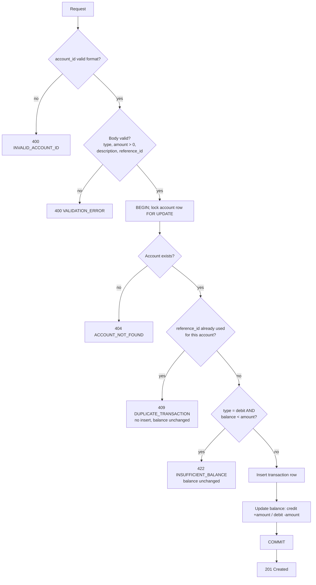
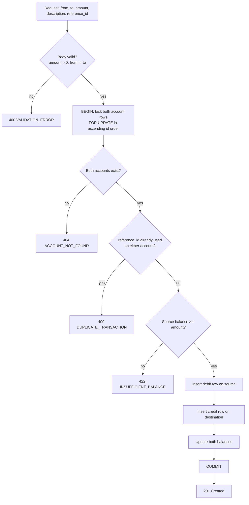

# Flow — Transaction Ledger API

Every write runs inside **one DB transaction**. Any error → rollback → nothing persisted.

## 1. Create Account — `POST /accounts`

1. Validate body: only `name`, non-blank. Unknown fields (e.g. `balance`) → 400.
2. Insert account (`balance = 0`, `created_at` set by DB).
3. Return 201 with `id, name, balance, created_at`.

## 2. Add Transaction — `POST /accounts/{account_id}/transactions`

Any failure between BEGIN and COMMIT → ROLLBACK (neither the row nor the balance change is saved).

## 3. Get Balance — `GET /accounts/{account_id}/balance`

1. Validate id format → 400 if invalid.
2. Look up account → 404 if missing.
3. Return `{ account_id, balance }`.

## 4. Get Transaction History — `GET /accounts/{account_id}/transactions?type=&page=&limit=`

1. Validate id format (400) and `type` ∈ {credit, debit} if given (400).
2. Validate `page` and `limit` (positive integers, limit ≤ 100; defaults 1 / 10) → 400 if invalid.
3. Account exists? → 404 if not.
4. Query the account's transactions, apply `type` filter if present, `ORDER BY created_at DESC, id DESC`, apply `LIMIT/OFFSET`.
5. Count total records for the same filter → `total_pages = ceil(total_records / limit)`.
6. Return `{ data: [...], pagination: { page, limit, total_records, total_pages } }`.

## 5. Transfer (Bonus) — `POST /transfers`

Any failure → ROLLBACK of the whole transfer. A partial transfer cannot be persisted.

## 6. Immutability

There are no `PUT`, `PATCH` or `DELETE` routes for transactions. A DB trigger also rejects `UPDATE`/`DELETE` on the `transactions` table.
